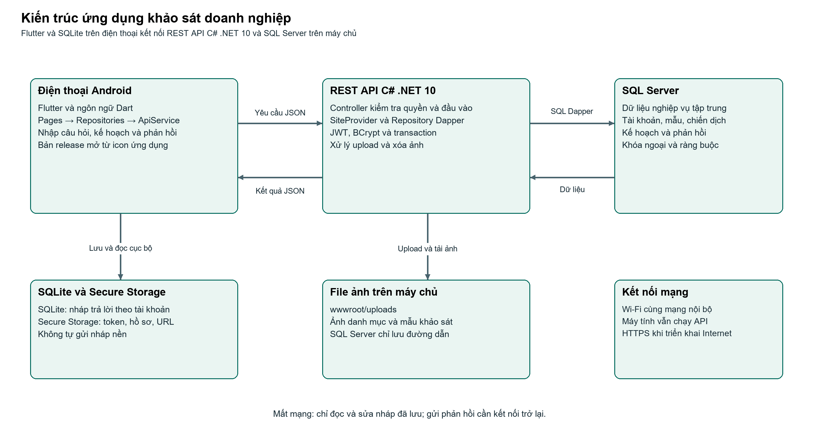

# Tổng quan và thuật ngữ

## Cách giới thiệu ngắn

Ứng dụng hỗ trợ doanh nghiệp quản lý mẫu khảo sát, lập kế hoạch và triển khai chiến dịch để thu thập ý kiến. Người tham gia trả lời trên điện thoại; chủ chiến dịch hoặc Admin xem kết quả. Flutter Dart làm giao diện Android, REST API C# ASP.NET Core 10 xử lý nghiệp vụ, SQL Server lưu dữ liệu tập trung và SQLite lưu nháp trên điện thoại.

## Các khái niệm cần phân biệt

| Khái niệm | Ý nghĩa | Ví dụ |
| --- | --- | --- |
| Danh mục Category | Phân nhóm các mẫu | Nhân sự, Khách hàng, Thị trường |
| Mẫu Survey | Bộ câu hỏi có thể được đưa vào chiến dịch | Mức độ hài lòng của nhân viên |
| Câu hỏi Question | Một mục trong bộ câu hỏi | Bạn hài lòng với môi trường làm việc ở mức nào? |
| Kế hoạch Plan | Các mẫu một tài khoản đang chuẩn bị triển khai | Hai mẫu với mục tiêu lần lượt 20 và 30 phản hồi |
| Chiến dịch Campaign | Đợt triển khai đã tạo từ kế hoạch | Khảo sát nhân sự quý 4 |
| Chi tiết CampaignItem | Một mẫu cụ thể trong một chiến dịch | Mẫu hài lòng nhân viên trong chiến dịch quý 4 |
| Phản hồi Response | Một lần trả lời của tài khoản cho CampaignItem | Các đáp án của một người tham gia |
| Nháp Draft | Nội dung trả lời chưa gửi, lưu trên điện thoại | Câu trả lời đang nhập dở |

SurveyId không phải CampaignId. ItemId là mã dòng chi tiết chiến dịch, không phải vị trí câu hỏi. Cùng một mẫu có thể được triển khai trong nhiều chiến dịch; một người có thể trả lời ở mỗi chiến dịch nhưng không gửi hai lần cho cùng ItemId.

## Công nghệ và vai trò

| Thành phần | Nhiệm vụ trong app |
| --- | --- |
| Flutter/Dart | Widget, màn hình, trạng thái, gọi API và lưu nháp |
| HTTP REST/JSON | Trao đổi dữ liệu giữa điện thoại và máy chủ |
| multipart/form-data | Gửi cả thông tin biểu mẫu và file ảnh |
| C# ASP.NET Core 10 | Endpoint, xác thực, phân quyền và nghiệp vụ |
| Dapper | Ánh xạ kết quả SQL thành object; vẫn viết SQL trực tiếp |
| SQL Server | Nguồn dữ liệu tập trung cho các tài khoản |
| SQLite/sqflite | Database cục bộ để lưu và mở nháp |
| Flutter Secure Storage | Token, hồ sơ phiên và địa chỉ máy chủ |
| JWT | Token có chữ ký và thời hạn, mang mã người dùng và vai trò |
| BCrypt | Băm và xác minh mật khẩu, không giải mã mật khẩu |

Flutter có khả năng đa nền tảng, nhưng bản này chỉ được kiểm chứng triển khai trên Android. Không tự nói đã chạy iOS/web/Windows.

## Bốn nơi chứa dữ liệu

1. SQL Server: tài khoản, danh mục, mẫu, kế hoạch, chiến dịch và phản hồi.
2. SQLite: nháp trả lời theo tài khoản và ItemId.
3. Secure Storage: token, hồ sơ để mở lại app và server_url.
4. wwwroot/uploads trên máy chủ: file ảnh; SQL Server lưu đường dẫn ảnh.

## Đọc code từ đâu

- Điểm bắt đầu Flutter: [main.dart](<../cuoiki/survey_app/lib/main.dart>) — dòng 10.
- Điểm bắt đầu API: [Program.cs](<../cuoiki/SurveyApi/Program.cs>) — dòng 6.
- Nháp cục bộ: [local_database.dart](<../cuoiki/survey_app/lib/local/local_database.dart>) — dòng 4.
- Đầu mối hiểu đối tượng: [survey.dart](<../cuoiki/survey_app/lib/models/survey.dart>) — dòng 40 và [Survey.cs](<../cuoiki/SurveyApi/Api/Models/Survey.cs>) — dòng 22.
