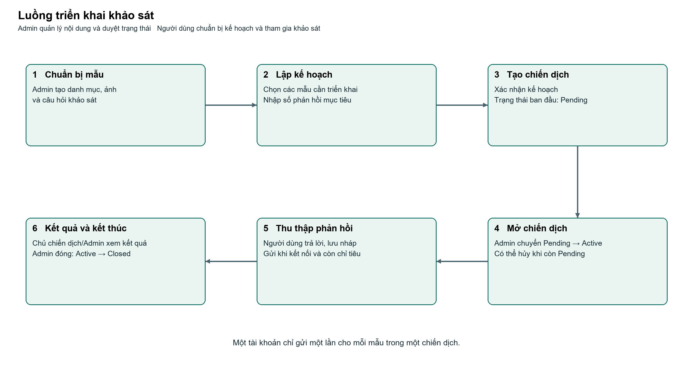

# Theo dõi từng chức năng từ giao diện tới dữ liệu

Cách dùng: mở Bản đồ màn hình để tới file Dart, sau đó mở các file C# theo chuỗi dưới. Repository Dart gọi HTTP; repository C# thực hiện SQL — hai lớp cùng tên nhưng khác vai trò.

## 1 Đăng ký
**Chuỗi xử lý:** LoginPage._submit với _register=true → MemberRepository.register/_post → POST /api/auth/register → AuthController.Register → MemberRepository.Add → Members.

Họ tên/email/mật khẩu kiểm tra cả client và server. Email được trim và chuẩn hóa lowercase. SQL chọn RoleId của Member; client không tự chọn Admin. BCrypt.HashPassword lưu hash. Email UNIQUE chống trùng; lỗi SQL 2601/2627 trả 409.

## 2 Đăng nhập
**Chuỗi xử lý:** LoginPage._submit → MemberRepository.login/_post → POST /api/auth/login → AuthController.Login → FindByEmail → BCrypt.Verify → tạo JWT → SessionHelper.save → HomePage.

JWT có NameIdentifier, Role và version, hết hạn sau 8 giờ. Mật khẩu không đi trong claims, PasswordHash không trả về hồ sơ công khai. Server kiểm tra IsActive trước khi cấp token.

## 3 Đổi mật khẩu hoặc logout
**Chuỗi xử lý:** ChangePasswordPage._save hoặc HomePage._logout → MemberRepository → AuthController → MemberRepository cập nhật TokenVersion.

Đổi mật khẩu: kiểm tra current, khác mật khẩu cũ, update hash kèm điều kiện oldHash và tăng version. Logout online tăng version, làm các token cũ của tài khoản bị từ chối. Flutter xóa phiên và nháp theo tài khoản. Logout offline chỉ xử lý cục bộ, chưa thu hồi được các phiên khác.

## 4 Thêm danh mục có ảnh
**Chuỗi xử lý:** CategoryPage._edit → _CategoryDialogState._pickImage/_save → SurveyRepository.saveCategory → POST /api/categories multipart → CategoryController.Add → ImageService.Save → CategoryRepository.Add.

Ảnh tùy chọn. API kiểm tra PNG/JPEG và dung lượng, lưu tên GUID; SQL chỉ nhận đường dẫn. Nếu SQL ghi lỗi sau khi đã upload, finally xóa file mới. Thêm không có ảnh thì ImagePath NULL.

## 5 Thay, bỏ hoặc xóa ảnh danh mục
**Chuỗi xử lý:** Dialog _save → PUT /api/categories/{id} → CategoryController.Update → CategoryRepository.Update → commit → ImageService.Delete(old).

Không chọn ảnh mới và không RemoveImage: giữ cũ. RemoveImage: đặt NULL; chọn ảnh mới: dùng đường dẫn mới. Xóa file cũ sau khi transaction ghi thành công. Xóa danh mục dùng Delete; FK chặn nếu còn mẫu, lúc đó file cũ giữ nguyên.

## 6 Thêm mẫu và câu hỏi
**Chuỗi xử lý:** SurveyEditPage._editQuestion → QuestionDialog._save → cập nhật _questions → SurveyEditPage._save → SurveyRepository.save → SurveyController.Add → SurveyRules.ValidateQuestions → ImageService.Save → SurveyRepository.Add.

Dialog chỉ trả object Question, chưa có API lưu câu hỏi riêng. Toàn bộ danh sách được jsonEncode vào questionsJson của multipart. Mẫu mới phải có ảnh. Server giới hạn 1–50 câu hỏi, mã dương không trùng, loại hợp lệ và đáp án 2–20 mục cho câu chọn.

## 7 Tìm mẫu và xem liên quan
**Chuỗi xử lý:** SurveyListView._load → SurveyRepository.categories/getPage → GET categories/surveys → SurveyRepository C#.GetPage; SurveyDetailsPage._loadRelated → GET surveys/{id}/related.

SQL lọc theo danh mục và tên trước khi COUNT và OFFSET/FETCH. Related tìm danh mục của mẫu gốc, lọc SurveyId khác mẫu gốc, xếp mã giảm dần. Không phải thuật toán gợi ý bằng AI.

## 8 Thêm kế hoạch, sửa chỉ tiêu và badge
**Chuỗi xử lý:** SurveyDetailsPage._addPlan → CampaignRepository.plan/putPlan → PlanController.Put → CampaignRepository.PutPlan → PlanItems; HomePage._refreshPlan lấy plan.length.

Khóa ghép MemberId+SurveyId chỉ một dòng mỗi mẫu trên mỗi tài khoản. PutPlan dùng transaction và upsert IF EXISTS; TargetCount giới hạn 1–100000. Badge là số mẫu, không là tổng chỉ tiêu. MemberId lấy từ JWT ở server.

## 9 Tạo chiến dịch
**Chuỗi xử lý:** PlanPage._checkout → CampaignRepository.checkout → POST /api/plan/checkout → PlanController.Checkout → CampaignRepository.Checkout → trả CampaignId → CampaignDetailsPage.

Tìm chiến dịch cùng MemberId/RequestId trước; đã có trả mã cũ. Chưa có: đọc kế hoạch, từ chối trống, giữ khóa các mẫu, INSERT Campaigns và CampaignItems, DELETE PlanItems, commit. Các bước tạo và xóa kế hoạch nằm cùng transaction.

## 10 Tìm, lọc và đổi trạng thái chiến dịch
**Chuỗi xử lý:** CampaignListPage._load → getPage → CampaignController.Get → CampaignRepository.GetPage; CampaignDetailsPage._status → Status → SetStatus.

Điều kiện quyền nằm trong WHERE trước tìm kiếm. open=true chỉ Active; open=false Member chỉ của mình, Admin toàn bộ. Status chỉ Admin, SQL WHERE kiểm tra trạng thái hiện tại; yêu cầu chuyển trái luồng không cập nhật dòng.

## 11 Mở nháp và gửi phản hồi
**Chuỗi xử lý:** ResponsePage._load → LocalDatabase.draft; không có nháp thì SurveyRepository.details. _submit → kiểm tra bắt buộc → xác nhận → _store → CampaignRepository.submit → CampaignController.Submit → CampaignRepository.Submit.

API giữ khóa Campaigns, tìm ItemId thuộc chiến dịch, kiểm tra phản hồi trước đó, trạng thái, chỉ tiêu và SurveyRules.ValidateAnswers. INSERT Responses rồi commit. Thành công client xóa nháp, lỗi giữ nháp. Cùng SubmissionId gửi lại trả thành công nhưng không ghi thêm; khác mã trên cùng ItemId/MemberId bị chặn.

## 12 Xem kết quả
**Chuỗi xử lý:** CampaignDetailsPage → ResultsPage._load → CampaignRepository.results → GET .../results → CampaignController.Results → CampaignRepository.Answers + SurveyRepository.Find.

API kiểm tra owner/Admin; đọc JSON phản hồi theo ItemId và câu hỏi theo mẫu. Text lấy nội dung không trống; option đếm số lần chọn; rating tính trung bình các giá trị số. Flutter hiển thị và tính phần trăm số chọn trên tổng phản hồi, nên câu nhiều lựa chọn có thể cộng hơn 100%.

## 13 Lưu kết nối Wi-Fi
**Chuỗi xử lý:** ServerSettingsPage._check → ApiService.normalizeUrl/checkServer → GET /api/health không JWT → saveServer → Secure Storage server_url.

Không có khóa bí mật trong kiểm tra URL. Địa chỉ áp dụng cả đăng nhập, nghiệp vụ và upload. Bản release không phụ thuộc Flutter debugger, nhưng dữ liệu online vẫn phụ thuộc máy tính chạy API/SQL Server. IP đổi thì cập nhật trong app.
