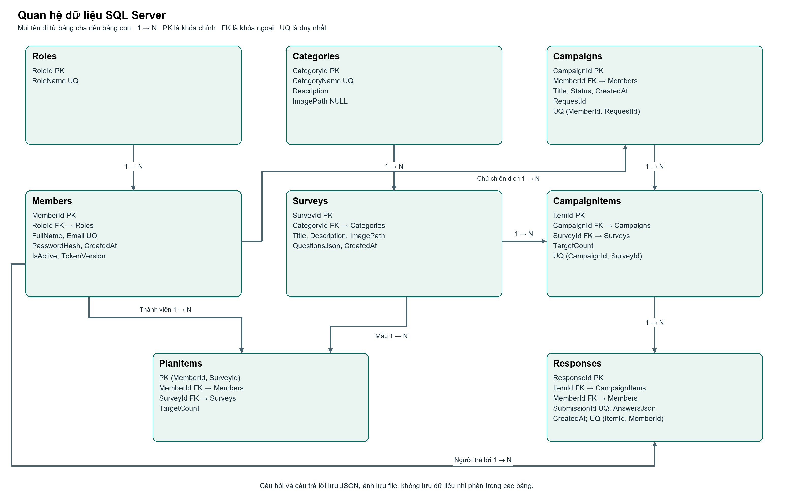

# Cơ sở dữ liệu và JSON

## Tám bảng SQL Server



| Bảng | Khóa và trường cần nhớ | Ý nghĩa |
| --- | --- | --- |
| Roles | RoleId PK; RoleName UNIQUE | Admin/Member cố định |
| Members | MemberId PK; RoleId FK; Email UNIQUE; FullName, PasswordHash, CreatedAt, IsActive, TokenVersion | Tài khoản và phiên |
| Categories | CategoryId PK; CategoryName UNIQUE; Description, ImagePath nullable | Nhóm mẫu khảo sát |
| Surveys | SurveyId PK; CategoryId FK; Title, Description, ImagePath, QuestionsJson, CreatedAt | Mẫu và bộ câu hỏi |
| PlanItems | PK ghép MemberId+SurveyId, cả hai FK; TargetCount | Kế hoạch đang chuẩn bị |
| Campaigns | CampaignId PK; MemberId FK; Title, Status, RequestId, CreatedAt; UNIQUE MemberId+RequestId | Chiến dịch |
| CampaignItems | ItemId PK; CampaignId FK, SurveyId FK; TargetCount; UNIQUE CampaignId+SurveyId | Mẫu trong đợt triển khai |
| Responses | ResponseId PK; ItemId FK, MemberId FK; SubmissionId UNIQUE; AnswersJson, CreatedAt; UNIQUE ItemId+MemberId | Phản hồi |

Quan hệ: Roles 1–N Members; Categories 1–N Surveys; Members 1–N Campaigns; Campaigns 1–N CampaignItems; Surveys 1–N CampaignItems. Members và Surveys liên hệ nhiều–nhiều qua PlanItems. Responses nối người tham gia với CampaignItem.

Không có bảng Orders, Products, Carts trong database đồ án này. Không có bảng Questions hay Answers riêng: câu hỏi và câu trả lời lưu JSON. Xem [004_surveys_campaigns.sql](<../cuoiki/SurveyApi/Database/004_surveys_campaigns.sql>) — dòng 5 và [005_category_images.sql](<../cuoiki/SurveyApi/Database/005_category_images.sql>) — dòng 4.

## SQLite phiên bản 2

[local_database.dart](<../cuoiki/survey_app/lib/local/local_database.dart>) — dòng 6 mở business_survey.db trên điện thoại. Bảng response_drafts là nơi lưu hiện tại, PK(member_id,item_id). Các trường campaign_id, payload_json và updated_at giúp mở lại đúng bản nháp. survey_drafts là bảng cũ giữ để tương thích và được dọn khi clearDrafts; luồng trả lời hiện tại không lưu vào bảng đó.

SQLite không có FK trực tiếp sang SQL Server. Các id trùng là tham chiếu nghiệp vụ; server luôn kiểm tra lại khi gửi. Token, member và server_url không nằm trong hai bảng này, chúng ở Secure Storage. Nháp SQLite hiện không có cơ chế mã hóa database riêng được triển khai trong code.

## Ví dụ JSON để hiểu

Các số và nội dung dưới đây là ví dụ giả lập để đọc cấu trúc, không phải dữ liệu được tạo thêm trong app.

QuestionsJson trong một Survey:

```json
[
  {"id":1,"title":"Góp ý","type":"text","required":true,"options":[]},
  {"id":2,"title":"Bạn hài lòng?","type":"single","required":true,"options":["Có","Không"]},
  {"id":3,"title":"Yếu tố quan tâm","type":"multiple","required":false,"options":["Giá","Chất lượng"]},
  {"id":4,"title":"Đánh giá","type":"rating","required":true,"options":[]}
]
```

Body gửi phản hồi:

```json
{
  "submissionId":"11111111-1111-4111-8111-111111111111",
  "answers":{"1":"Tốt","2":"Có","3":["Giá","Chất lượng"],"4":5}
}
```

Ở Responses chỉ AnswersJson lưu map answers, còn SubmissionId là cột riêng. Trong response_drafts.payload_json lưu object gồm survey (một bản nội dung mẫu), answers và submissionId. Đây là lý do đã có nháp thì mở mẫu mà không cần tải lại nội dung từ API.

## Truy vấn minh họa an toàn để giải thích

```sql
-- Chỉ đọc cấu trúc/quan hệ, không sửa dữ liệu.
SELECT c.CampaignId, c.Title, i.ItemId, s.Title AS SurveyTitle, i.TargetCount
FROM Campaigns c
JOIN CampaignItems i ON i.CampaignId=c.CampaignId
JOIN Surveys s ON s.SurveyId=i.SurveyId;

SELECT ItemId, COUNT(*) AS ResponseCount
FROM Responses GROUP BY ItemId;
```

Không chiếu SELECT PasswordHash hoặc dữ liệu cá nhân khi giải trình. Muốn chỉ dữ liệu nháp, mở LocalDatabase và Payload mẫu thay vì đưa token thật vào báo cáo.

## Thứ tự tạo database

001_initial.sql → 002_member_management.sql → 004_surveys_campaigns.sql → 005_category_images.sql. File 003_first_admin.sql là bước cấp Admin thủ công cho email đã đăng ký, không phải migration tự động. Tên database BusinessSurvey, khác database của hai dự án tham khảo.
