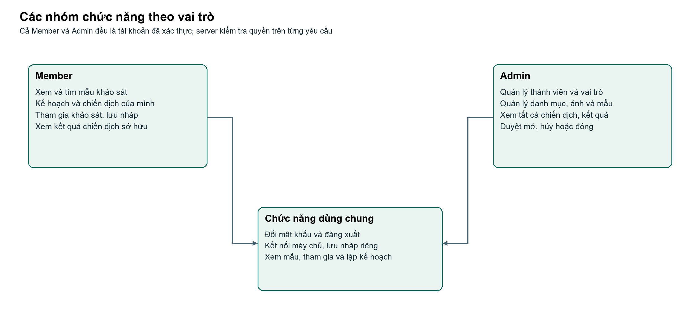

# Phân quyền và bảo toàn dữ liệu

## Bốn lớp kiểm tra

1. Flutter: validation biểu mẫu và ẩn/khóa nút cho trải nghiệm.
2. Controller/JWT: xác định đúng người dùng, vai trò và quyền sở hữu; API không lấy memberId chủ thể từ body client.
3. Repository và SurveyRules: trạng thái, chỉ tiêu, câu hỏi/đáp án và transaction.
4. SQL Server: FK, UNIQUE, CHECK và khóa trong transaction.

Không lớp nào thay thế toàn bộ các lớp khác. Một client khác vẫn gọi thẳng API được nên chỉ ẩn nút là chưa đủ.

## Các quyền khác nhau

- Admin quản trị thành viên, danh mục, mẫu và trạng thái chiến dịch.
- Member có kế hoạch/chiến dịch riêng; người khác chỉ đọc được chi tiết chiến dịch khi đang Active theo API.
- Xem kết quả: owner hoặc Admin. `canManage` trong Details phục vụ quyền này, không có nghĩa Member được đổi status.
- Nháp: đọc theo member_id hiện tại. Khôi phục hồ sơ offline không cho vượt JWT/role ở server.

Đọc [CampaignController.cs](<../cuoiki/SurveyApi/Api/Controllers/CampaignController.cs>) — dòng 28 và [CampaignController.cs](<../cuoiki/SurveyApi/Api/Controllers/CampaignController.cs>) — dòng 54 để thấy kiểm tra quyền khác nhau.

## Khóa phiên và mật khẩu

JWT chứa version so với Members.TokenVersion. Đổi mật khẩu, logout hoặc Admin cập nhật tài khoản làm tăng version. Middleware so sánh DB trên mỗi yêu cầu. Không có danh sách blacklist từng token; cách này thu hồi theo toàn tài khoản.

Đăng xuất offline chưa gọi được server nên chỉ xóa phiên và nháp cục bộ; app có thông báo chưa thu hồi các phiên khác. Đổi mật khẩu thành công cũng xóa nháp cục bộ trong ChangePasswordPage. Cần biết hành vi này để tránh thử với nháp đang cần giữ.

## Khóa ngoại và xóa dữ liệu

Danh mục có mẫu: FK chặn xóa. Mẫu đã dùng: repository chủ động kiểm tra CampaignItems và FK vẫn bảo vệ quan hệ. Thành viên có dữ liệu liên quan: API trả xung đột; khóa thay vì xóa. Không có chức năng xóa chiến dịch trong UI/API hiện tại.

## Transaction và yêu cầu đồng thời

Checkout dùng Serializable và UPDLOCK/HOLDLOCK cho vùng cần giữ ổn định. Submit giữ khóa bản ghi Campaigns, vì vậy các lần gửi vào cùng chiến dịch không tự do cùng lúc vượt qua count/target rồi cùng INSERT. Cách này ưu tiên tính đúng cho đồ án nhỏ, không nên khẳng định đã tối ưu cho hệ thống tải lớn.

Idempotency nghĩa là thử lại cùng yêu cầu hợp lệ không tạo tác dụng phụ trùng. RequestId của checkout được sinh khi PlanPage mở và lưu trong bộ nhớ trang; SubmissionId được giữ trong payload nháp SQLite nên sống qua việc đóng/mở app. UNIQUE trong DB là bảo vệ cuối, không chỉ kiểm tra tồn tại bằng SELECT thông thường.

## Upload ảnh

ImageService kiểm tra 8 byte đầu định dạng PNG hoặc dấu đầu JPEG và dung lượng; đây là kiểm tra chữ ký tệp cơ bản, không phải hệ thống quét malware hay giải mã xác minh toàn bộ ảnh. Server sinh tên GUID để không dùng tên file gốc làm đường dẫn. RequestSizeLimit 6000000 lớn hơn giới hạn file 5 MiB để chứa phần multipart.

File ảnh nằm ngoài transaction SQL Server. Code dọn file mới khi ghi lỗi và xóa file cũ sau khi ghi DB thành công; không tuyên bố file và SQL nằm trong một distributed transaction. Sự cố tiến trình/hệ thống file vẫn là giới hạn vận hành.

## Bảo vệ thực tế còn giới hạn

Mạng Wi-Fi nội bộ đang dùng HTTP nên dữ liệu đường truyền không được TLS mã hóa. HTTPS là yêu cầu khi đưa qua Internet. Ảnh upload được phục vụ qua UseStaticFiles, đường dẫn ảnh không có phân quyền riêng theo chủ sở hữu. SQLite nháp chưa được mã hóa database riêng. Không có MFA, rate limiting theo tài khoản hoặc refresh-token flow được triển khai trong code.
